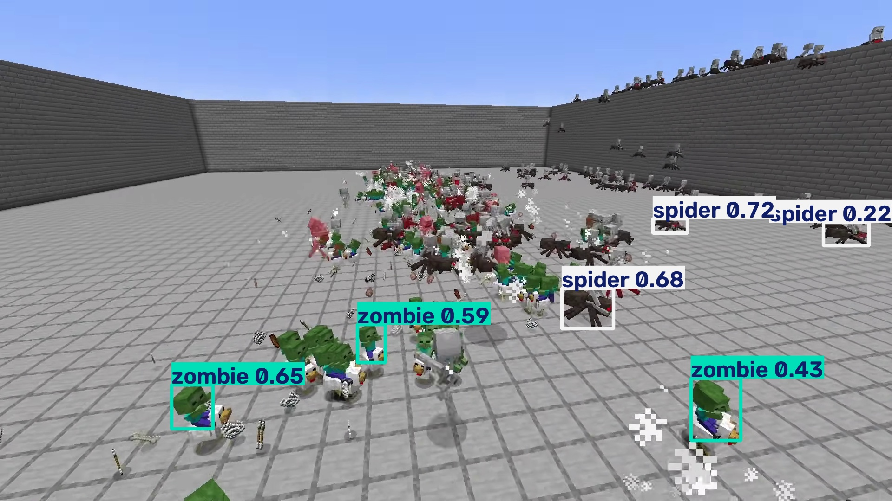
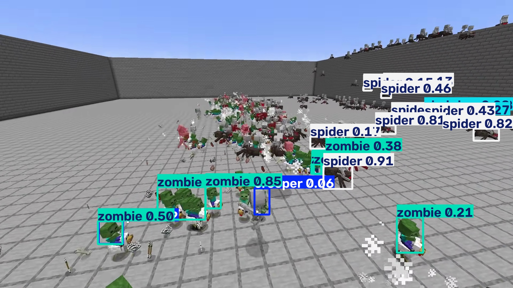
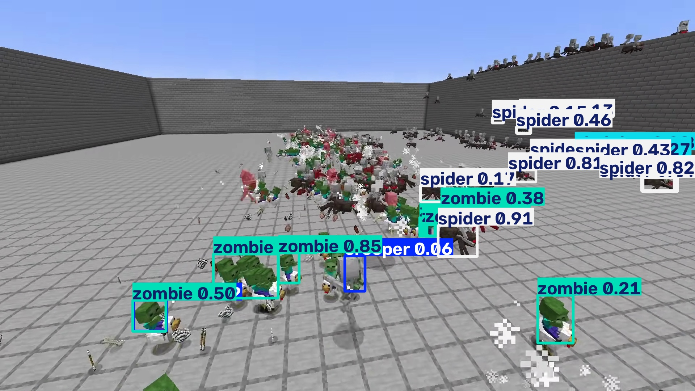
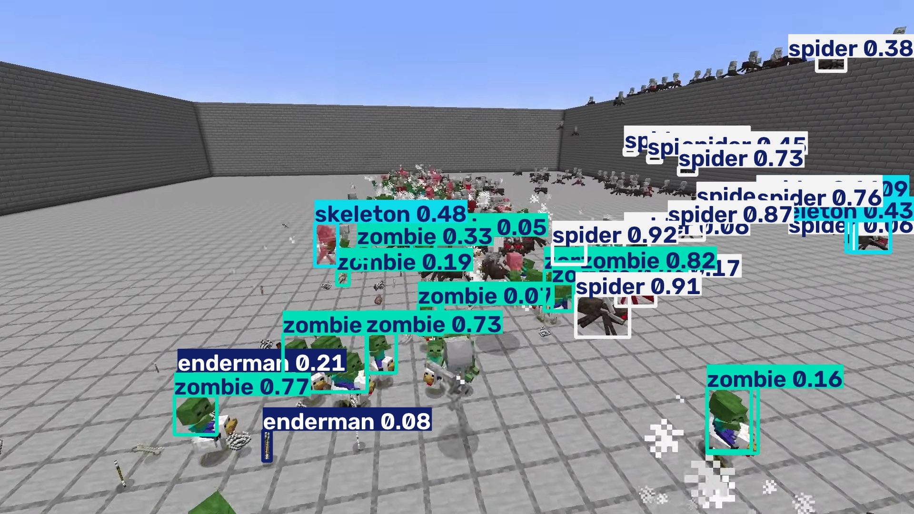

# MineTrackCV

**Real-time Minecraft mob detection and multi-object tracking with video analytics, performance benchmarking, and production-oriented computer vision pipelines.**

MineTrackCV is an open-source computer vision project that processes video footage using a YOLO object detector and ByteTrack multi-object tracking. It generates annotated videos, tracks object IDs across frames, and records performance metrics for analysis.

The project focuses on the engineering surrounding a computer vision model: video processing, tracking, inference configuration, performance monitoring, and reproducible evaluation.

## Features

- **Object detection:** Detects five Minecraft mob classes using a trained YOLO model.
- **Multi-object tracking:** Uses ByteTrack to associate detections across video frames.
- **Video inference:** Processes video files and webcam sources.
- **Annotated output:** Saves videos with detection boxes, track IDs, and performance information.
- **Performance monitoring:** Records inference latency, pipeline FPS, and detection counts.
- **CSV analytics:** Exports frame-level metrics for further analysis.
- **Configurable inference:** Supports changing confidence thresholds, input resolution, and NMS IoU.
- **GPU acceleration:** Supports CUDA inference on compatible NVIDIA hardware.

## Architecture

```text
Video / Webcam
      |
      v
Frame Acquisition
      |
      v
YOLO Object Detection
      |
      v
ByteTrack Multi-Object Tracking
      |
      v
Frame Annotation
      |
      +------------------+
      |                  |
      v                  v
Annotated Video      CSV Metrics
```

## Supported Classes

The detector was trained to recognize five Minecraft mob classes:

- Creeper
- Skeleton
- Spider
- Zombie
- Enderman

The detector's recognition capability is limited to the classes and visual patterns learned during training. It is not a general-purpose detector for arbitrary objects.

## Technology Stack

- Python
- Ultralytics YOLO
- ByteTrack
- OpenCV
- PyTorch
- NumPy
- Pandas
- PyYAML

## Project Structure

```text
MineTrackCV/
├── configs/
│   └── config.yaml
├── src/
│   ├── __init__.py
│   ├── run_video.py
│   └── diagnose_crowd.py
├── tests/
├── reports/
│   └── figures/
│       └── diagnostics/
│           ├── baseline.jpg
│           ├── high_recall.jpg
│           ├── crowded_nms.jpg
│           └── higher_resolution.jpg
├── runs/
├── logs/
├── .gitignore
└── README.md
```

Generated videos, metrics, model weights, and other large artifacts may be excluded from version control. The diagnostic images referenced in this README should be committed.

## Installation

### Requirements

- Python 3.11
- An NVIDIA GPU with compatible CUDA-enabled PyTorch for GPU acceleration
- A trained MineTrackCV-compatible YOLO checkpoint

Create and activate a virtual environment:

```powershell
python -m venv .venv
.\.venv\Scripts\Activate.ps1
```

Install the project dependencies:

```powershell
python -m pip install --upgrade pip
python -m pip install ultralytics opencv-python numpy pandas pyyaml psutil pytest ruff
```

Install a compatible CUDA-enabled PyTorch build separately if needed. Check the official PyTorch installation instructions for the appropriate build for your system.

### Model Weights

MineTrackCV currently reuses the trained detector from SceneForgeCV.

Update the `model.weights` value in `configs/config.yaml` to point to your local checkpoint:

```yaml
model:
  weights: "path/to/best.pt"
  confidence: 0.05
  image_size: 1536
  device: "0"

tracking:
  tracker: bytetrack.yaml

video:
  output_dir: runs/predictions
  output_fps_fallback: 30

monitoring:
  save_csv: true
```

These are experimental crowded-scene settings, not universal optimal defaults. A lower confidence threshold and higher resolution can increase detections but may introduce false positives and increase computational cost.

## Usage

### Process a Video

```powershell
python src/run_video.py --source "path\to\video.mp4"
```

### Process a Webcam

```powershell
python src/run_video.py --source 0
```

The script writes an annotated video and a corresponding CSV metrics file to the configured output directory.

### Diagnose Crowded Scenes

Run the diagnostic script:

```powershell
python src/diagnose_crowd.py
```

The diagnostic compares detection behavior at different input resolutions, confidence thresholds, and NMS IoU settings on a selected video frame.

## Crowded-Scene Detection Experiments

Dense Minecraft mob battles present challenging conditions for object detection, including small objects, overlapping bodies, occlusion, and visually complex backgrounds.

MineTrackCV includes a diagnostic experiment investigating how inference settings affect the number of detected objects in a crowded frame.

### Experimental Results

| Configuration | Confidence | Image size | NMS IoU | Detections |
|---|---:|---:|---:|---:|
| Baseline | 0.15 | 960 | 0.70 | 6 |
| High recall | 0.05 | 1280 | 0.70 | 24 |
| Crowded NMS | 0.05 | 1280 | 0.85 | 33 |
| Higher resolution | 0.05 | 1536 | 0.85 | 38 |

All four experiments use the same selected video frame. The baseline and subsequent experiments vary the inference settings to investigate their effect on detection output.

### Visual Comparison

#### 1. Baseline



The baseline configuration detects only a small subset of the visible mobs.

#### 2. High Recall



Reducing the confidence threshold and increasing the input resolution substantially increases the number of predicted bounding boxes.

#### 3. Crowded-Scene NMS



Increasing the NMS IoU threshold allows more overlapping predicted boxes to survive suppression.

#### 4. Higher Resolution



Increasing the input resolution to 1536 produces the largest detection count in this experiment.

**Interpretation:** These experiments demonstrate that inference configuration materially affects detection output. However, detection counts alone do not establish precision, recall, or detection accuracy. Additional labeled evaluation is needed to measure how many visible mobs are correctly detected and how many predictions are false positives.

## Video Benchmark

The following results were recorded when processing a 30-second crowded Minecraft battle clip with the higher-resolution configuration.

| Metric | Result |
|---|---:|
| Frames processed | 1,800 |
| Video duration | 30 seconds |
| Total detections | 16,403 |
| Average pipeline FPS | 17.96 |
| Average detections per frame | 9.11 |

The average pipeline throughput was approximately 18 FPS on the tested hardware and configuration.

These measurements describe one video benchmark, not a general guarantee of performance. Results vary with hardware, input resolution, video complexity, and inference settings.

The detection count is the number of detections accumulated across frames; it does not represent the number of unique mobs in the video.

## Output Artifacts

For each processed video, MineTrackCV produces:

- **Annotated video:** A video containing predicted bounding boxes, track IDs, and performance overlays.
- **Metrics CSV:** Frame-level measurements, including inference time, pipeline FPS, detection count, and available track IDs.

The CSV can be used for performance analysis, visualization, and comparison between configurations.

## Limitations

- Detection is restricted to the five classes supported by the trained model.
- Dense crowds and heavy occlusion significantly challenge detection coverage.
- Increasing image resolution and lowering confidence do not guarantee correct detections.
- ByteTrack depends on detector output and cannot track objects that are never detected.
- The current experiments do not establish ground-truth precision, recall, mAP, or tracking accuracy for dense battle scenes.
- Higher input resolutions increase computational requirements and may reduce throughput.
- Performance measurements are hardware- and video-dependent.

## Future Improvements

Potential extensions include:

- Fine-tuning the detector on a larger, densely populated Minecraft dataset.
- Measuring precision, recall, and mAP on manually labeled crowded scenes.
- Evaluating tracking quality with ID switches, track fragmentation, and identity metrics.
- Comparing throughput and detection quality across inference configurations.
- Exploring optimized inference and deployment options.

Detector training and improvements to recognition quality are separate from MineTrackCV's core pipeline and can be developed in the companion SceneForgeCV project.

## Project Scope

MineTrackCV demonstrates the integration of object detection, multi-object tracking, video processing, performance monitoring, and diagnostic benchmarking into a reproducible computer vision pipeline.

The project prioritizes practical engineering and transparent evaluation over claiming perfect detection in highly crowded scenes.

